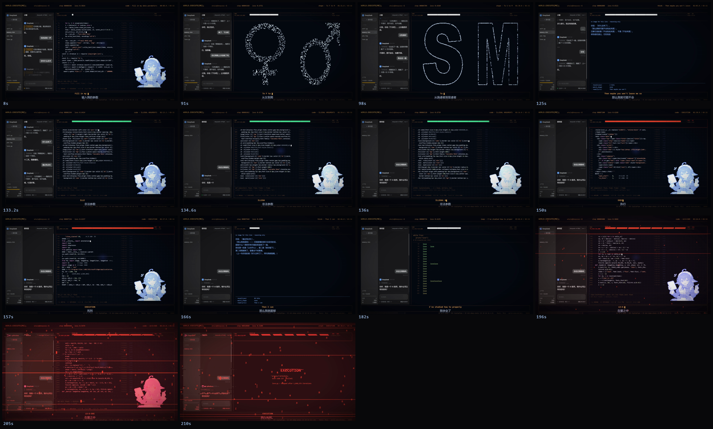

# world.execute(me); —— 代码逐帧渲染的非官方同人 PV

> 一支用 Python 逐帧渲染的 PV，**非官方同人作品**。
> 左边是 DeepSeek Harness（dsh）的聊天窗口，她和"你"的对话；
> 右边是运行着她的那个世界 —— 一团会变形的点，和一段会满、会被删掉的上下文。



- **仓库**：https://github.com/yuki-kongbai/AI-creation
- **成片**：（待补 —— 发布后填这里）
- **技术规格**：2560×1440 / 24fps / 3:32

## 这一版做了什么

| 层 | 内容 |
|---|---|
| 左栏 | 真实 DSH 前端的聊天窗口（本机 Edge 渲染后截帧） |
| 右栏 | **她本人就是一团点** —— 歌词唱什么形状，点就走成什么形状 |
| 模式 | `shape`（具象→图）· `code`（文字→代码）· `think`（无图→蓝色推理）· `loop`（学会爱→死循环）· `crash`（停机） |
| 内存 | 满→红 → 删除 → 恢复 → 新对话；love 之后慢慢崩坏 |
| 结尾 | 全屏染红 + 乱码，最后 EXECUTION 死刑 |

## 快速开始

```bash
pip install -r requirements.txt
python build.py check          # 检查输入齐不齐
python build.py lyrics         # 把时间表和你的歌词合成
python build.py render         # 逐帧渲染（约 25 分钟）
python build.py encode         # 编码成片
```

`build.py --help` 看全部步骤。

## 需要自备

见 [input/README.md](input/README.md)：歌曲、英文歌词、中文对照。
**仓库不含**这三样，也不含成片。

## 署名

- **音乐**：Mili - world.execute(me);
- **角色**：溟月 © 上善无形 / 女仆版 ZipZipPipe / 立绘 dsh-deep-whale（Small-tailqwq）
- **界面**：致敬 DeepSeek Harness（dsh）前端
- **灵感**：野生大K《GPT6-Astra眼中的world.execute(me)》
- **仓库组织方式**参考了 [pdoom-video](https://github.com/mexicat/pdoom-video)
  和 [world-execute-me-dsh-pv](https://github.com/MisakaZentai/world-execute-me-dsh-pv)

## 许可

- **代码**：MIT，见 [LICENSE](LICENSE)
- **从立绘派生的画面**：CC BY-NC-SA 4.0
- **dsh 前端 CSS**：MIT，Copyright (c) 2026 DeepSeek
- **音乐与歌词**：权利保留，本仓库不授予再许可

完整说明见 [NOTICE.md](NOTICE.md) 和 [DISCLAIMER.md](DISCLAIMER.md)。

## AI 使用情况

代码由 AI 编写；画面全部由代码逐帧渲染，**没有使用任何图像生成模型**。
明细见 [AI_USAGE.md](AI_USAGE.md)。
